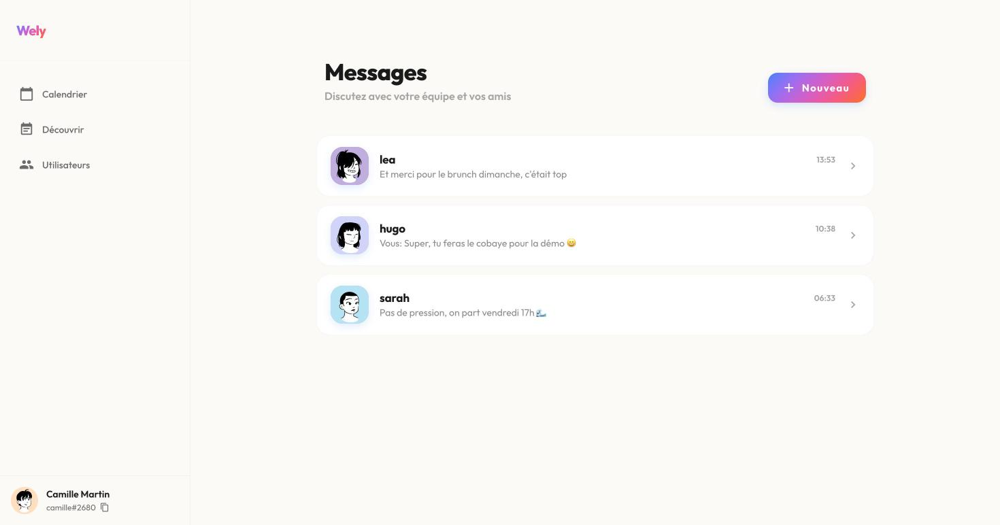
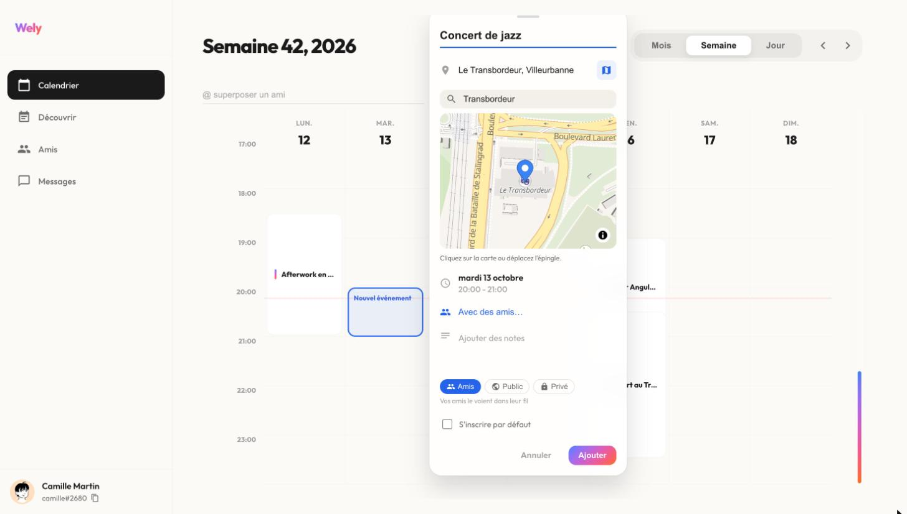

# wely-web

Frontend de la plateforme [Wely Calendar](https://github.com/WelyLabs/wely-platform) — application Angular 21 consommant l'API REST et le flux RSocket temps réel.

<p align="center">
  
</p>

<table>
  <tr>
    <td width="50%"></td>
    <td width="50%"></td>
  </tr>
  <tr>
    <td width="50%"></td>
    <td width="50%"></td>
  </tr>
</table>

> Captures du 11 octobre 2026, environnement `dev`, compte de démonstration. Plus de captures dans le [README de la plateforme](https://github.com/WelyLabs/wely-platform#lapplication).

---

## Stack

Angular 21 (standalone components) · Angular Material · Angular CDK · Tailwind CSS · RxJS 7 · **RSocket** (`rsocket-core`, `rsocket-websocket-client`) · `keycloak-angular` / `keycloak-js` · Vitest

---

## Fonctionnalités

| | |
|---|---|
| **Calendrier** | Vue mensuelle des événements auxquels l'utilisateur est inscrit |
| **Participation** | Le créateur d'un événement y est toujours inscrit ; tout membre peut le quitter : l'organisateur confie d'abord l'événement à un autre participant, et le dernier à partir le supprime, après confirmation |
| **Sondage de date** | L'organisateur propose de 2 à 5 créneaux ; ceux qui voient l'événement votent Oui / Peut-être / Non, en direct (Server-Sent Events) ; les créneaux proposés s'affichent en pointillés dans le calendrier, et fixer la date inscrit ceux qui ont voté Oui |
| **Feed** | Découverte des événements auxquels il n'est pas inscrit, en cartes à faire glisser ou sur une carte de la zone affichée, d'où on les rejoint |
| **Lieux** | Lieu d'un événement choisi sur une carte (MapLibre, tuiles OpenFreeMap) avec recherche d'adresse (Photon) ; mini-carte sur la page de l'événement |
| **Social** | Recherche d'utilisateurs, ajout par tag `Pseudo#1234`, demandes d'amis |
| **Messagerie** | Conversations temps réel via RSocket, historique paginé |
| **Appels** | Audio et vidéo depuis une conversation, ou avec tous les participants d'un événement (12 au plus) : sonnerie chiptune originale, micro et caméra coupables, caméra avant/arrière, la personne qui parle mise en avant |
| **Notifications** | Messages, appels, dates fixées, demandes d'ami : un toast dans l'app (Server-Sent Events), la cloche et sa page `/notifications` groupée par jour, et des notifications système (Web Push) quand l'app est fermée ; chaque catégorie se coupe dans les préférences |
| **Profil** | Consultation et édition, recadrage d'avatar |
| **Account** | Account deletion from the preferences, after a fresh sign-in; the demo account cannot be deleted |

---

## Structure

```
src/app/
├── core/                        infrastructure transverse
│   ├── auth/                    AuthService · keycloak-init.factory · config
│   ├── guards/                  authGuard
│   ├── interceptors/            SessionInterceptor
│   ├── storage/                 the app's wely.* keys in web storage
│   └── sse/                     flux SSE lu avec fetch, reconnexion
├── services/                    un service par domaine d'API
│   ├── user.service.ts          profil, token d'accès
│   ├── account-deletion.service.ts   account deletion flow
│   ├── deleted-users.service.ts      which user ids are deleted accounts
│   ├── social.service.ts        amis, demandes
│   ├── event.service.ts         événements, abonnements
│   ├── chat.service.ts          REST + RSocket
│   ├── navigation.service.ts
│   ├── notification.service.ts  toasts et retours locaux
│   ├── notification-center.service.ts   notifications, non-lues, SSE
│   └── push.service.ts          Web Push de l'appareil
├── components/                  composants standalone
│   ├── main-layout/             coquille applicative
│   ├── calendar/  event-feed/  event-details/  quick-event-popover/
│   ├── user-search/  user-card/  friends-list/  add-friend-dialog/
│   ├── conversations-list/  chat/  notifications/
│   ├── user-profile/  edit-profile-dialog/  avatar-upload-dialog/
│   └── shared/                  chat réutilisable, toast
├── models/                      interfaces TypeScript
└── environments/                dev · prod
```

---

## Routage

```typescript
{ path: '',  component: LandingPageComponent, pathMatch: 'full' },   // public
{ path: '',  component: MainLayoutComponent,
  canActivate: [authGuard],                                           // protégé
  children: [
    { path: 'calendar',        component: CalendarComponent },
    { path: 'feed',            component: EventFeedComponent },
    { path: 'users',           component: UserSearchComponent },
    { path: 'friends',         component: UserSearchComponent, data: { mode: 'friends' } },
    { path: 'event/:type/:id', component: EventDetailsComponent },
    { path: 'profile',         component: UserProfileComponent },
    { path: 'conversations',   component: ConversationsListComponent },
    { path: 'notifications',   component: NotificationsPageComponent },
    { path: 'chat/:convId',    component: ChatComponent },
    { path: 'call/:callId',    component: CallScreenComponent },
  ]
}
```

La landing page est publique ; tout le reste passe par `authGuard`, qui délègue à Keycloak.

---

## Authentification

L'application s'authentifie en OIDC auprès de Keycloak via `keycloak-angular`.

### Rafraîchissement proactif du token

Plutôt que de rafraîchir le token après un 401, `AuthService` le renouvelle **avant expiration**, en calculant le délai à partir du claim `exp` :

```typescript
const expirationDate = keycloakInstance.tokenParsed.exp * 1000;
const delay = expirationDate - Date.now() - 70_000;   // 70 s de marge
this.refreshTimer = setTimeout(() => this.executeTokenUpdate(), Math.max(delay, 1000));
```

Chaque rafraîchissement replanifie le suivant. L'utilisateur ne subit ni coupure ni requête rejouée.

`SessionInterceptor` reste en filet de sécurité : il intercepte les 401 et les `invalid_grant` — token révoqué côté Keycloak, session expirée en arrière-plan — et redirige vers le login.

### Account deletion

The *Compte* card on `/preferences` asks wely-users whether the account may be deleted (`GET /user-service/profile/deletion`); the demo account sees the action disabled and is never sent to Keycloak.

1. A destructive dialog lists the consequences and asks for the handle `name#1234`, typed back.
2. `AccountDeletionService` stores the request (time and `businessId`) in `sessionStorage`, then `AuthService.reauthenticate()` calls `keycloak.login({ prompt: 'login' })`: Keycloak skips SSO and asks for the password again, so the new token carries a fresh `auth_time`.
3. Back on `/preferences?account=delete` with a request under ten minutes old for the same account, the page offers the final step. wely-users checks `auth_time` itself (five minutes at most) and answers `403 USR-BUS-010` otherwise.
4. *Supprimer définitivement* unsubscribes Web Push and closes the notifications shown on the device while the identity is still valid, then sends `DELETE /user-service/profile`.
5. On `202`, `AuthService.leaveAfterAccountDeletion()` stops the token refresh, removes every `wely.*` key from both web storages, clears the token and replaces the page with `/?account=deleted`. That landing skips the silent SSO check: the Keycloak session lives a few more seconds, and its code exchange would fail.

If the `DELETE` fails with a network error, a `5xx` or `403 USR-BUS-010`, the app at once asks `GET /user-service/profile/deletion`: a `410 USR-BUS-012` there means the deletion went through. A `410 USR-BUS-012` on the caller's own profile endpoints, or a `410` on the notification stream, sends the account's other devices to the same landing.

Elsewhere, a deleted account reads *Utilisateur supprimé* with a neutral avatar: `DeletedUsersService` asks wely-users (`POST /user-service/users/deleted`, batched, cached for the session) about the ids a screen's directory cannot name; a failed request is sent again a minute later on its own, up to three attempts, so a screen already open still turns the label on. A private conversation with a deleted account stays readable but becomes read-only, from wely-chat's `readOnly` flag.

### Le claim `businessId`

Le token émis par Keycloak porte un claim `businessId` injecté par un [mapper de protocole custom](https://github.com/WelyLabs/wely-identity). Le frontend n'a donc jamais à traduire un UUID Keycloak en identifiant métier : les services lisent l'identité directement dans le token.

---

## Temps réel

`ChatService` gère la connexion RSocket au-dessus de WebSocket.

```
   ┌────────────────────────────────────────────────────────────┐
   │                      ChatService                           │
   │                                                            │
   │   REST (HttpClient)                RSocket                 │
   │   ├─ getConversation()             ├─ chat.send            │
   │   ├─ getAllConversations()         │    request/response   │
   │   ├─ getConversationById()         └─ chat.stream          │
   │   └─ getMessages(bucketIndex)           request/stream     │
   │                                              │             │
   │                                         messages$          │
   │                                      (flux unique, tous    │
   │                                       les correspondants)  │
   └────────────────────────────────────────────────────────────┘
```

**Un seul flux pour toute l'application** : `chat.stream` est ouvert une fois et expose `messages$`, que les composants filtrent selon la conversation affichée. Pas un abonnement par conversation.

Le JWT est transmis à chaque appel dans la métadonnée d'authentification RSocket :

```typescript
const tokenBuffer = Buffer.concat([Buffer.from([0x81]), Buffer.from(token)]);
return encodeCompositeMetadata([
    [MESSAGE_RSOCKET_ROUTING, encodeRoute(route)],
    [MESSAGE_RSOCKET_AUTHENTICATION, tokenBuffer],
]);
```

La connexion se reconnecte automatiquement en cas de coupure, et le flux se reprend après un délai.

### Appels

Le son et l'image ne passent pas par nos serveurs : le navigateur ouvre **une** `RTCPeerConnection` vers le SFU de Cloudflare Realtime, y publie son micro et sa caméra et y reçoit les pistes des autres. wely-chat, qui détient la clé Cloudflare, vérifie chaque étape et relaie la négociation.

| Pièce | Rôle |
|---|---|
| `CallService` | L'appel de bout en bout : `call.events` (second flux RSocket sur la même connexion), entrée et sortie, micro et caméra, *heartbeat* toutes les 15 s, état en signals |
| `CallSession` | La connexion WebRTC, sans Angular : publication (offer → answer du SFU), abonnement (offer du SFU → answer du navigateur), une négociation à la fois |
| `SpeakerDetector` | Qui parle, d'après le volume reçu : grande tuile et caméra en pleine résolution ; les autres reçoivent une couche *simulcast* plus petite à mesure que la grille se remplit |
| `Ringtone` | La sonnerie : une mélodie originale en ondes carrées (Web Audio), sans fichier ; vibration quand le navigateur bloque le son |
| `CallOverlayComponent` | Sur toutes les pages : le bandeau d'appel entrant, et la barre « Appel en cours · Revenir » |

### Notifications

wely-notifications (`/api/v1/notifications-service`) tient la liste. Deux canaux en partent :

| Pièce | Rôle |
|---|---|
| `NotificationCenterService` | La liste (première page, puis « Voir plus »), le compteur de non-lues et le passage à lu, optimiste. Un flux SSE (`/notifications/stream`) lu avec `fetch`, comme le sondage, car `EventSource` ne sait pas envoyer le jeton ; reconnexion avec un délai qui double jusqu'à 30 s (`core/sse/sse-stream.ts`, partagé avec le sondage) |
| `NotificationToastComponent` | Le toast d'une notification arrivée pendant que l'app est ouverte, sauf si l'écran concerné est déjà affiché (la conversation ouverte) et sauf l'appel entrant, qui sonne déjà |
| `PushService` | Le Web Push de l'appareil : permission demandée au clic, abonnement avec la clé VAPID du serveur, puis `PUT /push/subscriptions` |
| `public/sw.js` | Le service worker, en JS brut et sans cache : il affiche la notification système, sauf si un onglet Wely est visible, et au clic met l'onglet au premier plan et y fait naviguer l'app |

Ouvrir une conversation marque ses notifications lues. La cloche est dans la barre latérale sur
ordinateur ; sur téléphone, le compteur s'affiche sur l'onglet « Moi », dont le menu ouvre la page.

**Sur iPhone**, Safari ne reçoit les notifications push que si Wely a été ajoutée à l'écran
d'accueil (Partager → Sur l'écran d'accueil) et ouverte depuis là : les préférences l'expliquent
plutôt que de proposer un interrupteur inopérant.

nginx sert `sw.js` sans cache, pour qu'un correctif arrive au prochain chargement.

---

## Configuration

`src/environments/` — trois fichiers, un par cible.

| Clé | dev | prod |
|---|---|---|
| `apiUrl` | `http://localhost:8081/api/v1` | `/api/v1` |
| `rsocketUrl` | `ws://localhost:8081/rsocket` | `/rsocket` |
| `keycloakUrl` | `http://localhost:8080` | `https://auth.welylabs.app` |

En production, l'URL Keycloak est **injectée au démarrage du conteneur** : `entrypoint.sh` substitue les variables dans `index.html` via `envsubst`, ce qui permet de déployer la même image sur plusieurs environnements sans rebuild.

---

## Démarrage

```bash
npm ci --legacy-peer-deps
npm start                  # http://localhost:4200
```

La gateway (`:8081`) et Keycloak (`:8080`) doivent tourner — voir le [README racine](https://github.com/WelyLabs/wely-platform).

---

## Scripts

```bash
npm start           # serveur de développement
npm run build       # build de production → dist/calendar-app/browser
npm run watch       # build incrémental
npm test            # tests unitaires (Vitest)
```

28 fichiers de test couvrant les services, les guards, l'intercepteur et les composants. La couverture est publiée sur SonarCloud (`sonar-project.properties`).

---

## Build et déploiement

Image multi-étapes : build Node, service par nginx.

```dockerfile
# Une seule étape : le bundle est compilé avant l'image, pas dedans.
FROM nginxinc/nginx-unprivileged:stable-alpine
COPY nginx.conf /etc/nginx/templates/default.conf.template   # envsubst au démarrage
COPY --chown=101:101 dist/calendar-app/browser /usr/share/nginx/html
ENTRYPOINT ["/entrypoint.sh"]
```

**Pourquoi le bundle n'est plus compilé dans l'image.** Elle est publiée pour `linux/amd64` *et*
`linux/arm64` — le cluster tourne sur des Raspberry Pi — et `buildx` exécute chaque étape une
fois par plateforme, la passe arm64 sous émulation QEMU. Un build Angular émulé est des dizaines
de fois plus lent : le job est passé de deux minutes à six heures, puis a fini par pendre. Les
services Java n'ont jamais eu le problème, leurs images ne font que copier un jar déjà compilé.

Le workflow compile donc le bundle **une fois, nativement**, et l'image ne fait plus qu'une copie
de fichiers — quelques secondes par architecture. Conséquence à connaître : un `docker build .`
sans build préalable échoue sur le `COPY`, avec un message explicite plutôt qu'une racine web
vide.

```bash
npm ci --legacy-peer-deps && npm run build -- --configuration production
docker build -t wely-web .
```

---

## Limites connues

- **La recherche d'utilisateurs filtre côté client** sur la liste complète renvoyée par
  `wely-social`. À déplacer côté serveur avec pagination — en l'état, la liste grandit avec le
  nombre d'inscrits.
- **`rsocket-core` est en version alpha** (`0.0.29-alpha.0`), sur la ligne legacy de
  `rsocket-js`. Les typages de `src/types/rsocket.d.ts` sont écrits à la main faute de mieux.
- **L'état `pending` / `failed` d'un message n'est pas affiché.** `ChatService` marque bien un
  message envoyé mais non acquitté, et `ChatMessage` transporte les deux drapeaux — mais le
  template de `SharedChatComponent` les ignore. Un message perdu ressemble donc à un message
  envoyé jusqu'au prochain rechargement.
- **`FriendsListComponent` est du code mort** : aucune route, aucun import, et construit sur
  `MOCK_FRIENDS` avec un `setTimeout` simulant un appel réseau. Non modernisé volontairement ; à
  supprimer ou à brancher sur `wely-social`.
- **Les événements personnels du calendrier sont des données simulées.** `wely-events` modélise
  les événements auxquels on s'abonne, pas un agenda personnel : les trois entrées de
  `CalendarComponent.personalEvents` ne sont persistées nulle part.
- **Le chat d'un événement est un placeholder.** `ConversationType.EVENT` existe dans le domaine
  de `wely-chat` sans implémentation derrière, donc `EventDetailsComponent` affiche trois messages
  en dur.
- **Le bouton « Ajouter » d'une carte utilisateur ne fait rien.** Une demande d'ami part par tag
  via `AddFriendDialogComponent` : les résultats de recherche ne portent pas le hashtag dont
  `wely-social` a besoin pour identifier quelqu'un.

### Ce qui a été corrigé

Ces points figuraient ici et ne s'appliquent plus, mais valent d'être mentionnés parce que
l'historique Git les documente :

| Point | Correctif |
|---|---|
| Pas de linter | `eslint.config.js` + `angular-eslint`, de ~400 erreurs à 0 |
| Style pré-signals | 18 composants sur 18 en `OnPush`, état en signals, `input()` / `output()` / `viewChild()` |
| Souscriptions non fermées | `takeUntilDestroyed()` partout, `toSignal()` là où un flux *est* l'état |
| `any` sur la couche RSocket | typages réels dans `src/types/rsocket.d.ts`, plus aucun `any` |
| `console.log` en production | `LoggerService`, silencieux hors développement |
| Échecs d'envoi optimiste ignorés | le flux n'est plus complété avant la réponse serveur |
| `environment.prod.ts` non typé | interface `Environment` partagée |
